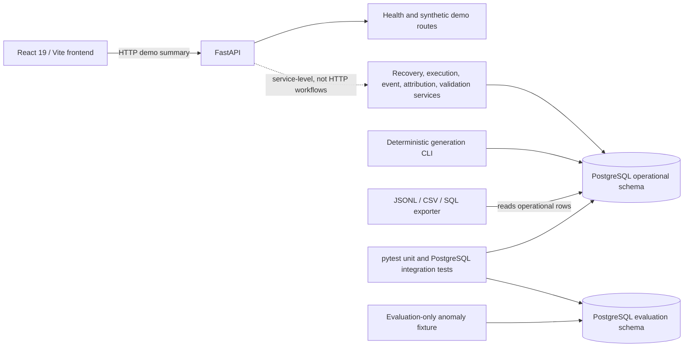

# YottaFlex AI — Recruitment Drive
## Candidate Project Submission Guidelines

**YOUR CHALLENGE WINDOW — 72 HOURS**

The submission window is 72 hours. Artifact timestamps will be used to verify the window.

This README makes no claim that the submission window was met. Record and verify the actual start/deadline and artifact timestamps before submitting.

### 01 — MAKE IT RUN
**EXECUTABLE**

Submit working, executable code. Include clear steps so another person can install dependencies, configure the project, run it, and verify key behavior.

### 02 — SHOW YOUR WORK
**PUBLIC REPOSITORY**

Use a public GitHub repository. Make the evolution of your work understandable through the code, meaningful commits, and supporting context.

**Repository URL:** `[Add the actual public repository URL after confirming it is publicly accessible.]`

### 03 — USE LLMs TRANSPARENTLY
**PROMPT HISTORY REQUIRED**

LLM tools are allowed. Submit your prompt history and explain where AI accelerated your work, where you relied heavily on it, and what you personally reviewed, changed, or validated.

### 04 — MAKE YOUR REASONING VISIBLE
**EXPLAIN THE WHY**

Help reviewers understand the problem, assumptions, key decisions, trade-offs, testing approach, limitations, and how you know the solution works.

> **BE READY TO WALK US THROUGH YOUR SOLUTION.**
>
> We value sound judgment, working software, honest AI disclosure, and clear communication.

**YottaFlex.AI — Consent-Aware Abandoned Cart Recovery and Attribution Platform**

## Project overview

### Problem and intended users

Uncoordinated abandoned-cart outreach can message customers after they withdraw consent, target carts that were already purchased, or misstate which campaign drove an order. This project models those recovery and attribution concerns with durable event history, explicit policies, database constraints, deterministic examples, and anomaly detectors.

The intended audience is ecommerce lifecycle/CRM teams, analytics stakeholders, and engineers evaluating recovery-policy behavior and campaign attribution. The potential business value is safer consent-aware outreach, more auditable recovery decisions, and consistent single-order attribution. The repository implements a service-level prototype and demonstration, not a production-connected ecommerce platform.

### Implemented functionality and boundaries

- Recovery services evaluate cart activity, purchase state, customer/channel consent, frequency caps, and compatible campaigns/templates; logical schedules are rechecked at dispatch.
- Send execution simulates provider outcomes. Message send, delivery, open, and click events support idempotent ingestion and append-only history.
- Attribution uses a provisional last-eligible-click policy for the same customer/cart within seven days before order placement. A unique order constraint prevents multiple canonical credits; deterministic tie-breaking is covered by tests.
- Synthetic data generation uses stable identifiers, a fixed scenario time, seed `20261022`, and parent-first ordering. The generator provides JSONL, CSV, and SQL operational exports.
- Operational anomaly detection covers a send after consent withdrawal, a cart abandoned after a linked purchase, a duplicate canonical attribution if present in legacy data, and a cart total inconsistent with its line quantities.
- The cross-campaign double-attribution example is deliberately evaluation-only. Operational database uniqueness is not weakened to create duplicate credits.
- Ground-truth labels live in the separate PostgreSQL `evaluation` schema. Operational services and exports do not include those labels.
- FastAPI exposes health/readiness endpoints and a synthetic demo summary. Recovery workflows are currently service-level, not operational HTTP routes. The React/Vite dashboard displays synthetic API data rather than generator tables.

The four anomaly scenarios are set up together by `test_required_anomaly_scenarios_are_detected_and_labels_stay_separate` in [tests/integration/test_recovery_services.py](tests/integration/test_recovery_services.py). The case is a PostgreSQL integration test: its presence in source does not mean it passed in a run where the integration suite was skipped.

### Architecture



The backend is a Python modular monolith using FastAPI, SQLAlchemy 2.0 with psycopg 3, PostgreSQL, Alembic, and pytest. The frontend is React with Vite. SQLAlchemy metadata separates operational tables from evaluation metadata. Docker Compose defines a dedicated PostgreSQL test service bound to loopback port `5433`; a separate development service is declared on port `5432`.

### Key design decisions and trade-offs

| Decision | Rationale and trade-off |
|---|---|
| Re-evaluate channel-specific consent when dispatching | A customer can withdraw consent after scheduling. Eligibility must be current at execution; this favors compliance over sending every planned message. |
| Keep event history and detect anomalies rather than silently repair source facts | Preserving the observed facts supports auditability and evaluation. A mismatched cart projection is reported, not automatically corrected by the detector. |
| Enforce one canonical attribution per order in the operational schema | A database uniqueness constraint is the final integrity boundary. It prevents storing the exact duplicate the evaluation fixture models. |
| Isolate ground truth from operational data | Evaluation labels must not influence business decisions or leak into business exports. The trade-off is that an evaluation-only anomaly cannot be detected from operational rows alone. |
| Use fixed time, seed, stable IDs, and stable ordering | These make synthetic runs comparable and debugging repeatable; the dataset is illustrative rather than representative of a live population. |
| Export explicit formats instead of relying on database dumps | JSONL is line-oriented and table-qualified; CSV writes per-table files and an export manifest; SQL emits dependency-ordered inserts. All three include operational rows (including the source `GenerationRun` manifest) and exclude evaluation labels. Consumers must respect each format's null and import conventions. |

Recovery thresholds and attribution windows are configurable provisional defaults, not approved business policy. See [docs/business_rules.md](docs/business_rules.md), [docs/decision_log.md](docs/decision_log.md), [docs/data_dictionary.md](docs/data_dictionary.md), and [docs/implementation_plan.md](docs/implementation_plan.md) for further detail.

## Setup and run (Windows PowerShell)

The documented setup targets Windows 10/11 with Docker Desktop, Docker Compose, Python 3.11+, and Node.js/npm. The package declares Python `>=3.11`; the local environment used for this handover reported Python `3.13.14`, Node `v26.13.0`, npm `11.1.0`, and Docker Compose `v5.6.1`. These are observed local versions, not minimum versions for every dependency. No non-Windows setup is documented here.

Run commands from the repository root.

### 1. Create the Python environment

```powershell
py -m venv .venv
.\.venv\Scripts\python.exe -m pip install -e ".[dev]"
```

The Python project and development dependencies are defined in [pyproject.toml](pyproject.toml). The frontend lockfile is [frontend/package-lock.json](frontend/package-lock.json).

### 2. Configure local environment variables safely

```powershell
Copy-Item .env.example .env
```

Edit the local `.env` file and replace the database URL placeholders with the actual test-only values from your local secret manager. The settings loader reads `.env`; `DATABASE_URL` is used by Alembic and the generator, while `TEST_DATABASE_URL` is used by integration-test fixtures. Keep `.env` uncommitted. Do not copy real credentials into the README, source control, or terminal output.

For the isolated test service, both URLs must resolve to `yottaflex_test` as `yottaflex_ci` on `127.0.0.1:5433`. Use the required SQLAlchemy driver name `postgresql+psycopg`. Do not target native PostgreSQL or the development service on port `5432` for these verification steps.

The URL shape is `postgresql+psycopg://yottaflex_ci:<URL-ENCODED_TEST_PASSWORD>@127.0.0.1:5433/yottaflex_test`; replace the placeholder locally and use the same test-only target for both settings. URL-encode reserved characters in the password.

Compose requires two strong, test-only environment values supplied locally or by a secret manager: `YOTTAFLEX_TEST_ADMIN_PASSWORD` and `YOTTAFLEX_TEST_DB_PASSWORD`. They must be available to the Compose process before starting the service; do not print or commit them.

### 3. Start the isolated PostgreSQL test database

```powershell
docker compose up -d --wait postgres-test
docker compose ps postgres-test
```

The `postgres-test` service uses PostgreSQL 17 Alpine, binds only to `127.0.0.1:5433`, and initializes database `yottaflex_test` for the non-superuser role `yottaflex_ci`. The SQL init script is [scripts/init-test-db-user.sh](scripts/init-test-db-user.sh).

Before any migration, database test, or generation, verify the effective URL targets without printing credentials:

```powershell
@'
from app.core.config import get_settings
from sqlalchemy.engine import make_url

settings = get_settings()
expected = ("127.0.0.1", 5433, "yottaflex_test", "yottaflex_ci")
for name, value in (
    ("DATABASE_URL", settings.database_url),
    ("TEST_DATABASE_URL", settings.test_database_url),
):
    if value is None:
        raise SystemExit(f"{name} is not configured")
    url = make_url(value)
    target = (url.host, url.port, url.database, url.username)
    print(f"{name}: host={url.host} port={url.port} database={url.database} username={url.username}")
    if target != expected:
        raise SystemExit(f"{name} does not target the dedicated test database")
print("Both URLs target the isolated test database.")
'@ | .\.venv\Scripts\python.exe -
```

Stop if either target differs. Integration fixtures truncate test tables; use only the isolated test database and expect those fixtures to reset its contents. Do not run these commands against native/development/production data.

### 4. Apply and inspect Alembic migrations

Only after verifying `DATABASE_URL`:

```powershell
.\.venv\Scripts\python.exe -m alembic upgrade head
.\.venv\Scripts\python.exe -m alembic current
```

The first command applies migrations. `alembic current` reports the database's applied revision; `alembic heads` only reports repository head revisions and is not a substitute for checking the database.

### 5. Start the backend and inspect the API

In a PowerShell terminal with the local environment configured:

```powershell
.\.venv\Scripts\python.exe -m uvicorn app.main:app --host 127.0.0.1 --port 8000
```

- Frontend/backend API: `http://127.0.0.1:8000`
- OpenAPI documentation: `http://127.0.0.1:8000/docs`
- Liveness: `http://127.0.0.1:8000/health/live`
- Readiness (checks PostgreSQL): `http://127.0.0.1:8000/health/ready`
- Synthetic demo API: `http://127.0.0.1:8000/api/demo/summary`

The frontend defaults to `http://localhost:8000/api/demo/summary`; `VITE_API_URL` can override this base URL. The demo response is fixed synthetic data and is not derived from the generated PostgreSQL data.

### 6. Install and start the frontend

If frontend dependencies are not installed:

```powershell
Push-Location frontend
npm ci
Pop-Location
```

Start Vite in another terminal:

```powershell
Push-Location frontend
npm run dev -- --host 127.0.0.1 --port 5173
Pop-Location
```

Open the frontend at `http://127.0.0.1:5173/`. The backend allows the local Vite origins.

## Tests and verification

Run from the repository root. Ensure both database URLs were safely verified before running the PostgreSQL integration or full suite:

```powershell
.\.venv\Scripts\python.exe -m pytest -m unit -q
.\.venv\Scripts\python.exe -m pytest -m integration -q
.\.venv\Scripts\python.exe -m pytest -q
Push-Location frontend
npm run build
Pop-Location
```

The full suite includes PostgreSQL integration tests when configured. If they skip because `TEST_DATABASE_URL` is missing, the output is not evidence that PostgreSQL integration passed. The integration fixtures truncate tables in the configured test database. Test scopes and markers are configured in [pyproject.toml](pyproject.toml); tests are organized under [tests/unit/](tests/unit/) and [tests/integration/](tests/integration/).

### Latest verifiable results

Latest run available for this handover:

| Check | Result |
|---|---|
| `.\.venv\Scripts\python.exe -m pytest -m unit -q` | **52 passed, 38 deselected** |
| `.\.venv\Scripts\python.exe -m pytest -q` | **59 passed, 31 skipped** because `TEST_DATABASE_URL` was unavailable. The skipped tests are PostgreSQL integration tests; this is not a full integration pass. |
| `npm run build` in `frontend` | **Passed**, Vite 8.3.5 |
| `.\.venv\Scripts\python.exe -m alembic heads` | **`8b38919cdbcf (head)`** |
| `.\.venv\Scripts\python.exe -m alembic current` | **Not run** against a database in this latest verification. |
| JSONL / CSV / SQL generator CLI exports | **Not run** in this latest verification. |

The pytest run emitted a Starlette deprecation warning about using `httpx` with `starlette.testclient`; it did not fail the passing tests.

An earlier verification snapshot in [docs/validation_summary.md](docs/validation_summary.md) records 52 unit tests, 31 PostgreSQL integration tests, and 89 total tests passing, plus a successful database migration and export checks. Treat those as **previously documented results, not the latest verification**; rerun the documented commands before relying on them for submission. That report records that the four anomaly scenarios and integrity checks were validated in its PostgreSQL run.

### Integrity and anomaly verification

The integration suite's generation tests check seed/config manifest consistency, rerun determinism, evaluation-schema separation, foreign-key relationships, absence of orphan rows, and consent-aware schedule creation. Schema and service tests check database constraints, event idempotency, purchase/consent decisions, and canonical attribution uniqueness. The dedicated anomaly integration test adds the four required cases and asserts:

1. A message event timestamped after consent withdrawal is detected.
2. A cart abandonment event after a linked purchase is detected.
3. Cross-campaign double-credit is represented in evaluation fixture data; a second operational canonical credit is rejected and existing canonical credit is reused.
4. A changed cart-line quantity with an unchanged stored cart total is detected.

Three findings are read from operational rows. The double-attribution case is detected from evaluation-only legacy fixture data because the operational constraint correctly prevents inserting two canonical credits. Latest-run status: the corresponding integration test was skipped and has **not** been reverified in that run.

### Determinism evidence recorded by earlier validation

[docs/source_manifest.md](docs/source_manifest.md) records a previous small-profile validation using seed `20261022` and reference time `2026-10-22T00:00:00+00:00`. It reports identical logical dataset hashes across two rollback-only runs:

- Logical dataset SHA-256: `c6089965b87828a464e82cdbdb922e19e18e9d0f2c0f4b4589252c1d3a66d2f1`
- Configuration SHA-256: `a14fe7dd0f6dcc9e9419434cf2198e2c780f408a9291b6651caf9444ab377fb1`
- Repeated operational JSONL SHA-256: `29d7be7a62a0864dd24ae47cba43cecced263dc551fb7060d28c061dd4e3a45e`

Those are historical values from the validation document, not freshly generated values in the latest run. The same document records zero orphan line/order/attempt/event counts and zero arithmetic errors in that prior small-profile run. See that report for its exact row counts and scale-profile snapshot.

## Synthetic data generation and exports

The CLI is `python -m app.generation`. It supports `generate`, `rebuild`, `hash`, and `export`; `generate` accepts `--profile {small,scale}`, optional `--seed`, `--reference-time`, and `--batch-size`. `export` supports `--format {jsonl,csv,sql}` and `--output`. The CLI help was checked against the installed project.

Use a verified `DATABASE_URL`, a migrated **empty isolated test database**, or a database already containing the identical configuration. The generator will not add a different dataset to a non-empty database. Do not use `rebuild` as a shortcut; it is destructive.

```powershell
# Generate the small deterministic profile.
.\.venv\Scripts\python.exe -m app.generation generate --profile small --seed 20261022 --reference-time "2026-10-22T00:00:00+00:00"

# Hash the logical dataset (operational plus evaluation rows).
.\.venv\Scripts\python.exe -m app.generation hash

# JSONL: one table-qualified row per line; includes the source GenerationRun manifest.
$jsonlPath = Join-Path $env:TEMP "yottaflex-small.jsonl"
.\.venv\Scripts\python.exe -m app.generation export --format jsonl --output $jsonlPath
Get-FileHash -Algorithm SHA256 $jsonlPath

# CSV: one file per operational table plus export-manifest.json.
# The output directory must not already contain files.
$csvDirectory = Join-Path $env:TEMP ("yottaflex-small-csv-" + (Get-Date -Format "yyyyMMddHHmmss"))
.\.venv\Scripts\python.exe -m app.generation export --format csv --output $csvDirectory
Get-Content (Join-Path $csvDirectory "export-manifest.json")

# SQL: dependency-ordered PostgreSQL INSERTs, wrapped in BEGIN/COMMIT.
$sqlPath = Join-Path $env:TEMP "yottaflex-small.sql"
.\.venv\Scripts\python.exe -m app.generation export --format sql --output $sqlPath
Get-FileHash -Algorithm SHA256 $sqlPath
```

JSONL includes operational rows and the source generation manifest, but not evaluation rows or labels. CSV writes every operational table, including `generation_run`, under `operational/`, plus `export-manifest.json`; SQL writes dependency-ordered inserts for operational tables, including `generation_run`. Both omit evaluation data and labels. CSV uses `\N` as the null sentinel and escapes a literal `\N`. SQL requires migrations first and an empty operational schema to import without key conflicts. The CSV output directory must be empty. Do not import an export into a database with live or unrelated data.

For a reproducibility check, rerun the same configuration in an isolated rollback-only integration test or fresh isolated database and compare logical hashes and output checksums. Relational integrity and SQL importability are covered by PostgreSQL integration tests, not by merely generating an export file. The latest CLI runs were not performed; do not report fresh export success or checksums until those commands have completed.

## AI Assistance and Human Validation

The repository does not include an actual prompt-history artifact, and available evidence does not establish who authored or personally reviewed the pre-existing application changes. Do not infer prior AI use or human review from the existence of source files or tests.

| Activity | AI assistance | Human review or validation | Supporting evidence |
|---|---|---|---|
| Existing application architecture, schema, generation, and tests | Specific AI contributions are not established by the available prompt history. | Individual human review is not established by repository evidence. | Existing implementation and tests under [app/](app/), [alembic/](alembic/), and [tests/](tests/); authorship/review history is not supplied here. |
| README update for this submission | AI assistance inspected repository documentation/configuration and drafted this README update. | `git diff --check`, command/help inspection, and path checks are recorded for this README update; personal review by the candidate must be completed and disclosed by the candidate. | This README change and the current conversation; no standalone prompt-history artifact was found in the repository. |
| Earlier test and data validation | No claim is made about AI's contribution to earlier implementation or validation. | Earlier test/migration/export results are documented in [docs/validation_summary.md](docs/validation_summary.md); the latest rerun status is stated above. | Validation document and current recorded command results. |

**Prompt-history artifact required before submission:** `[Attach or link the actual AI prompt history before submission.]`

Do not replace the required artifact with a reconstructed transcript. Before submitting, add a truthful account of where AI accelerated the work or was relied upon heavily, what you personally reviewed or changed, and what evidence you used to validate it. AI-generated code should be reviewed and validated through relevant tests, database constraints, reproducibility checks, and manual inspection; this README does not claim that all such reviews were performed by the candidate.

## Assumptions, trade-offs, and limitations

### Assumptions and scope

- Recovery and attribution policy defaults are provisional; business owners have not confirmed all threshold, event-ordering, refund, currency, and window-boundary semantics. The rationale/open decisions are in [docs/business_rules.md](docs/business_rules.md).
- Synthetic scenario time and random seed are explicit so outcomes do not depend on wall-clock time or uncontrolled random state.
- Operational event facts remain distinct from ground-truth labels. Evaluation fixtures may describe legacy conditions that current operational constraints refuse to persist.
- FastAPI serves health checks and a synthetic demo summary; recovery decisions, schedules, dispatch, and attribution are not exposed as operational HTTP workflows.

### Known limitations and future improvements

- No external messaging provider delivery, exactly-once delivery guarantee, authentication/authorization layer, or production deployment configuration is included.
- The dashboard is synthetic and fixed-payload, not backed by generated operational data.
- Attribution is a provisional last-click policy, same customer/cart, within seven days before placement, with deterministic tie-breaking; endpoints and broader business semantics require confirmation.
- Cross-campaign duplicate canonical attribution is not stored in operational tables; the anomaly is represented in evaluation-only legacy fixture data.
- Scale profile counts were recorded in an earlier rollback-only validation; scale rows were not retained.
- Latest PostgreSQL integration, `alembic current`, and JSONL/CSV/SQL CLI export checks remain outstanding.

### Reviewer reproduction checklist

1. Follow the Windows setup steps and verify both effective database targets before migration or tests.
2. Run `alembic upgrade head`, then `alembic current`.
3. Run unit tests, PostgreSQL integration tests, full pytest, and the frontend production build using the commands above. Confirm the integration tests did not skip.
4. Generate the small profile on an empty or identically populated isolated test database, export all three formats, and record actual counts/hashes from the command output.
5. Inspect the generation/export integration tests for referential integrity, cart arithmetic, evaluation separation, SQL import, and repeatability; run the anomaly integration test against PostgreSQL.
6. Review the actual prompt-history artifact, repository visibility/history, and artifact timestamps before making submission claims.

For database connection failures, verify the service with `docker compose ps postgres-test`, then recheck that both URLs target loopback port `5433`, database `yottaflex_test`, and role `yottaflex_ci`; never fall back to port `5432`. For migration failures, verify `DATABASE_URL` before retrying and inspect `alembic current`/`alembic heads`. For skipped integration tests, configure `TEST_DATABASE_URL` and rerun against the migrated isolated database. For generator failures, check that `DATABASE_URL` is configured, migrations are applied, the dataset is empty or matches the same generation configuration, and the CSV destination is an empty directory.

## Further documentation

- [docs/business_rules.md](docs/business_rules.md) — confirmed requirements and provisional policy decisions.
- [docs/decision_log.md](docs/decision_log.md) — design decisions and their status.
- [docs/data_dictionary.md](docs/data_dictionary.md) — schema and entity guide.
- [docs/implementation_plan.md](docs/implementation_plan.md) — project phases and completion boundaries.
- [docs/source_manifest.md](docs/source_manifest.md) — recorded synthetic data counts and prior reproducibility hashes.
- [docs/validation_summary.md](docs/validation_summary.md) — previously recorded test, migration, API, and export evidence.
